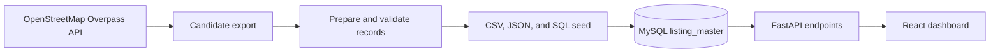

<div align="center">

# Bengaluru Business Listings Dashboard

**Explore local businesses through an interactive, source-linked dashboard.**

Built with React, FastAPI, and MySQL. The prepared Bengaluru dataset contains **534 listings** and meets the assignment's 500+ requirement.


</div>

## At a glance

| | |
| --- | --- |
| **Dashboard** | Category mix, phone coverage, postcode patterns, listing map, and data-quality checks |
| **Data source** | OpenStreetMap shop listings collected through the Overpass API |
| **Prepared seed** | 534 listings with names, categories, cities, addresses, source links, IDs, and coordinates |
| **Phone coverage** | 39 of 534 listings (7.3%); phone numbers are optional and are never invented |
| **Run locally** | Docker Compose starts MySQL, FastAPI, and the React dashboard |

## Dashboard features

- **Summary cards** for listing totals, categories, phone availability, and mapped coordinates.
- **Category chart** with counts and percentages for the top 10 categories.
- **Interactive map** with source-linked listing details.
- **Contact and postcode analysis** based on the fields actually present in the data.
- **Data-quality checks** for repeated names, duplicate source IDs, unclassified `yes` tags, and addresses without a detected postcode.
- **Listings table** with address, available phone, source, and source ID.

## How it works



The collector queries named shop features in a bounding box covering Bengaluru. The preparation step removes records without the required listing details, normalizes the city, and keeps each source ID so separate branches are not merged by name. Missing phone numbers remain SQL `NULL`.

## Quick start

### Prerequisites

- Docker Desktop or another Docker Engine with Docker Compose
- Python 3.10+ only if you want to run the CSV importer or collection scripts outside Docker

### Start the app

1. Create your local environment file and replace the example passwords:

   ```bash
   cp .env.example .env
   ```

2. Build and start the services from the project root:

   ```bash
   docker compose up --build -d
   ```

3. Wait for the database and API to become healthy:

   ```bash
   docker compose ps
   ```

4. Open the dashboard and API documentation:

   - Dashboard: <http://localhost:5173>
   - FastAPI docs: <http://localhost:8000/docs>
   - Health check: <http://localhost:8000/api/health>

On a fresh MySQL volume, Compose initializes the schema and 534-row SQL seed. Existing volumes are not reseeded automatically. To import the prepared CSV into an already-running API:

```bash
python3 backend/app/import_csv.py data/bengaluru_complete.csv --api http://localhost:8000
```

The importer upserts by `(source, source_id)` and reports `received: 534`. Check the live database total at <http://localhost:8000/api/dashboard/summary>. Avoid `docker compose down -v` unless you intend to delete the local database volume.

## API reference

| Method | Endpoint | Purpose |
| --- | --- | --- |
| `GET` | `/api/health` | API and database readiness |
| `GET` | `/api/dashboard/summary` | Total listings, category/source totals, and phone/address coverage |
| `GET` | `/api/dashboard/cities` | Listing count by city |
| `GET` | `/api/dashboard/categories` | Listing count by category |
| `GET` | `/api/dashboard/sources` | Listing count by source |
| `GET` | `/api/listings?limit=1000` | Source-linked listing records; limit is capped at 1,000 |
| `POST` | `/api/listings/bulk` | Validate and bulk upsert a listing batch |

Interactive API documentation is available at <http://localhost:8000/docs> after startup.

## Data and provenance

The committed prepared dataset is `data/bengaluru_complete.csv` and `.json`. The SQL seed in `database/listings_dump.sql` contains **534 rows**. The larger `data/bengaluru_osm_shop_candidates.json` export contains **1,865 candidates**, including records that the preparation step excludes when required details are missing.

To collect a new candidate export and regenerate the prepared CSV, JSON, and SQL files:

```bash
python3 scripts/collect_osm_candidates.py
python3 scripts/prepare_verified_data.py
```

OpenStreetMap data is © OpenStreetMap contributors and is available under the [Open Database License (ODbL)](https://www.openstreetmap.org/copyright). The dashboard provides attribution, and the dataset retains source links and IDs. Review ODbL attribution and share-alike obligations before redistributing an adapted database. This project uses OSM and does not scrape Google Maps, Justdial, or Sulekha.

## Data limitations

- The prepared seed contains 534 listings, not the earlier 1,000-record stretch target.
- Only 39 listings have a phone number (7.3%); avoid broad conclusions from that small sample.
- Every prepared row is from Bengaluru and OpenStreetMap, so city and source comparisons each have only one group.
- 176 addresses contain a detected six-digit postcode; the other 358 do not.
- Eight records use the OSM category tag `yes`, which may mean the category is unspecified.
- OSM listings can be outdated. Source provenance does not guarantee that a business or contact detail is current.

## Project structure

```text
backend/       FastAPI app, MySQL connection, schemas, and CSV importer
database/      MySQL schema and 534-row seed dump
data/          Prepared listings and OSM candidate export
docs/          Timed demo walkthrough
frontend/      React dashboard and map
scripts/       OSM collector and data-preparation pipeline
```

## Demo walkthrough

The 3–5 minute recording guide is in [`docs/demo-script.md`](docs/demo-script.md). It covers the collection approach, API, MySQL seed, dashboard, and known data limits.
